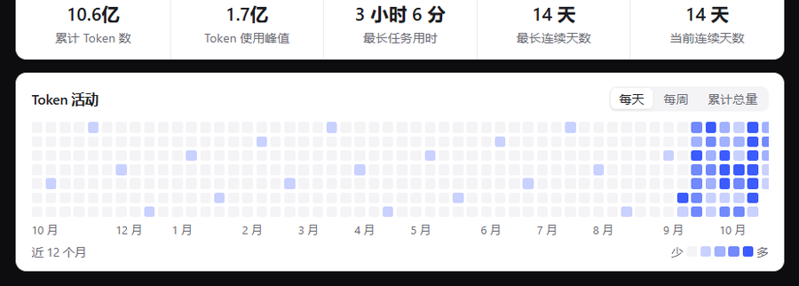

# dsh-hainnu

在 DSH 里登录海南师范大学账号，把学校自部署的 DeepSeek 接成 DSH 的模型。

> 由 DeepSeek-V4.1（2026-10-17）编写 · 欢迎海师师生使用



## 这是什么

一个 DSH 插件。装好之后，左侧栏会多一个「海师账号」入口：

- 填一次学号/工号和密码，之后自动登录，令牌过期会自动续；
- 本机起一个 OpenAI 兼容的代理，把学校自部署模型 + 「海师大智汇」的三个阿里云模型一起接进 DSH；
- 四个模型都能调工具（读文件、跑命令、写代码），三个阿里云模型由插件转协议实现；
- 面板里能看到登录状态、代理状态、每个模型的简介与能力、token 用量热力图，以及**插件版本与更新提醒**。

接进来的模型分两个来源，名字里直接标出来：

| 模型 | 来源 | 上下文 / 输出 | 工具调用 | 图片 |
| --- | --- | --- | --- | --- |
| `deepseek-flash` | 海师自部署（1017 构建） | 300,000 / 80,000 | 原生 function calling | ✅ |
| `kimi-k3` | 海师阿里云 | 1,000,000 / 131,072 | 插件转协议 | ❌ |
| `qwen3.8-flash` | 海师阿里云 | 256,000 / 65,536 | 插件转协议 | ❌ |
| `deepseek-v4.1-flash` | 海师阿里云 | 1,000,000 / 131,072 | 插件转协议 | ❌ |

自部署那个走学校的 Open WebUI（`chat.hainnu.edu.cn`），后三个走「海师大智汇」
智能体平台（`hsaixy.hainnu.edu.cn`）背后的阿里云百炼，两者共用同一套学号密码，
插件会用同一份凭据各自登录、各自续期。多轮对话优先复用平台会话（只发新增的那条
消息），会话对不上时自动新开一个并带上完整上下文。

三个平台模型的差异：

- **思考**：平台只有开关没有档位。DSH 里选 **off** 就不带思考，其余档位保持平台默认（开）。
- **温度**：Kimi K3 固定 1（改温度平台会报错），Qwen3.8 / DeepSeek V4.1 用 0.7；进 agent 模式时插件会把可调温度的模型压到 0.2。
- **工具**：平台没有原生 function calling，插件用文本协议把它们接成标准 `tool_calls`。
  0.2.0 起**两种格式都认**——`<tool_call>{…}</tool_call>`，以及 DSH 自己的
  `<|DSML| invoke name="…">` 写法。所以三个模型在 DSH 里能正常读文件、跑命令、调用工具。
- **输出预算**：平台默认只给 2K–8K，插件实测平台会兑现更高额度，于是提到 131,072 / 65,536；
  以前「想太久导致空回复」的问题主要就是预算太小。
- **画图能力**（同题盲测：让四个模型各画一张「SVG 鹈鹕骑车」）：自部署产出 22–36 KB、细节最多；
  三个阿里云模型约 10–12 KB，构图完整但更简洁。

密码和令牌只加密存在本机，仓库里没有任何凭据。

## 安装

前置：DSH 桌面版（0.2.x）。

**1. 下载本仓库到任意目录**（下文记作 `<插件目录>`，例如 `D:\dsh\dsh-hainnu`）。

**2. 链接进 DSH 的 profile：**

```bat
:: Windows（cmd，junction 不需要管理员权限）
mklink /J %USERPROFILE%\.dsh\profiles\desktop\node_modules\dsh-hainnu <插件目录>
```

```bash
# macOS / Linux
ln -s "<插件目录>" ~/.dsh/profiles/desktop/node_modules/dsh-hainnu
```

**3. 在 `%USERPROFILE%\.dsh\profiles\desktop\cordis.patch.yml` 末尾追加：**

```yaml
- insert:
    - id: dsh-hainnu
      name: dsh-hainnu
      config:
        port: 8787
        localApiKey: sk-hainnu
        autoStart: true
        autoLogin: true
```

> `id: dsh-hainnu` 在同一份文件里只能出现一次。

**4. 重启 DSH**，打开左侧栏「海师账号」，填账号密码登录。

## 版本与更新

面板「状态」卡片里有一行**版本**：显示当前版本，并自动检查仓库有没有新版本。

考虑到国内直连 GitHub 经常超时，检查会按顺序回退四个源：

| 顺序 | 源 | 说明 | 实测 |
|---|---|---|---|
| 1 | `api.github.com/.../releases/latest` | 最准，还能拿到 release 标题与时间 | 1s ✅ |
| 2 | `data.jsdelivr.com/v1/packages/gh/<repo>` | 列 tag，发版后立刻可见 | 1s ✅ |
| 3 | `cdn.jsdelivr.net/gh/<repo>@main/package.json` | CDN 读默认分支，可能滞后几小时 | 暂时偏旧 |
| 4 | `fastly.jsdelivr.net/...` | jsDelivr 的 fastly 镜像 | 兜底 |

三个都失败时，面板会显示「检查更新失败，手动查看 ↗」，点开就是 Releases 页。
宿主侧有 10 分钟缓存，不会频繁打网络；想强制刷新可以访问 `/dsh-hainnu/check-update?force=1`。

> 源 2 用的是 jsDelivr 的版本列表接口，**发版后立刻能看到**；源 3 读的是默认分支、带缓存，可能滞后几小时，只作兜底。

## 使用

面板从上到下：

- **状态** —— 登录、令牌有效期、代理地址、当前模型
- **可用模型** —— 四个模型的来源、上下文 / 输出上限、能否看图、工具调用是原生还是模拟，以及每个模型适合干什么
- **用量** —— 经过代理的累计 token、单日峰值、最长任务用时、连续天数和活动热力图
  （绿色深浅表示忙闲，列数按面板宽度自适应，最新一天永远在最右边，随日期自动滑动）
- **账号** —— 登录 / 只存密码 / 退出登录 / 忘记密码
- **代理** —— 启动、停止、重启、重新写入模型配置
- **诊断** —— 最近一次错误的原因

## 配置

配置写在上面第 3 步的 `config` 里，常用的几个：

| 键 | 默认 | 说明 |
|---|---|---|
| `port` | `8787` | 本地代理端口，被占用会自动顺延 |
| `autoLogin` | `true` | 启动时令牌不可用就自动登录 |
| `autoStart` | `true` | DSH 启动时自动拉起代理 |
| `allowRemote` | `false` | 从其他设备远程访问 DSH 时才需要打开 |

完整配置项、模型策略和接口清单见 [docs/技术细节.md](docs/技术细节.md)。

## 常见问题

**8787 被旧项目的 Python 代理占用怎么办？**
不用管。插件不会抢端口，识别出是同一个海师代理后会直接接管它（面板显示「接管外部实例」），外部实例退出后 30 秒内自动接手。

**改了 `cordis.patch.yml` 没生效？**
只改注释不会触发重载，`config` 里的实际值变了才会。

**侧栏没有出现「海师账号」？**
先确认 `cordis.patch.yml` 里 `dsh-hainnu` 只出现了一次；再看浏览器控制台有没有 `slot entry crashed`。

## 说明

- 学校**连续 5 次密码错误会锁账号**。插件不会盲目重试：自动登录连续失败会暂停一段时间再试。
- 密码只允许提交到学校自己的域名；本地代理没配好访问 Key 时直接拒绝请求，而不是放行。
- 所有端口只监听本机回环地址，并对请求来源做校验。
- 只支持 OpenAI 兼容接口（`/v1/chat/completions`）。

## 开发

```bash
npm test
```

全部是离线测试，不联网、不碰真实令牌。

## 许可证

MIT。登录流程与代理转发语义来自 [hainnu-proxy](https://github.com/sapphirestar46/hainnu-proxy)（MIT），本项目把它重写成了 DSH 插件。

那个 Python 版项目仍然有用：**如果你想在其他 agent（WorkBuddy、ZCode、Trae 等）上使用海师自部署的 DeepSeek，
或者把 API 分发给自己的其他设备，直接用 [hainnu-proxy](https://github.com/sapphirestar46/hainnu-proxy) 更合适**——
它不依赖 DSH，纯 Python 起一个 OpenAI 兼容服务就行。本插件则是给 DSH 用户准备的完整封装（自动登录、Token 续期、模型配置、面板）。
